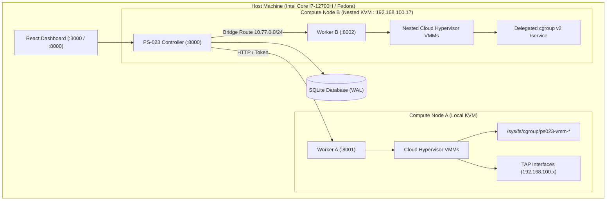
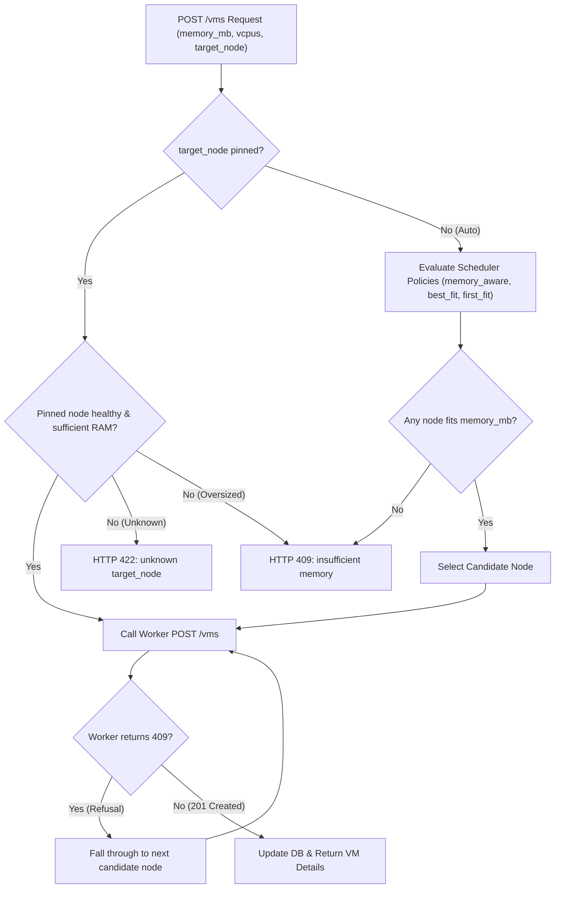
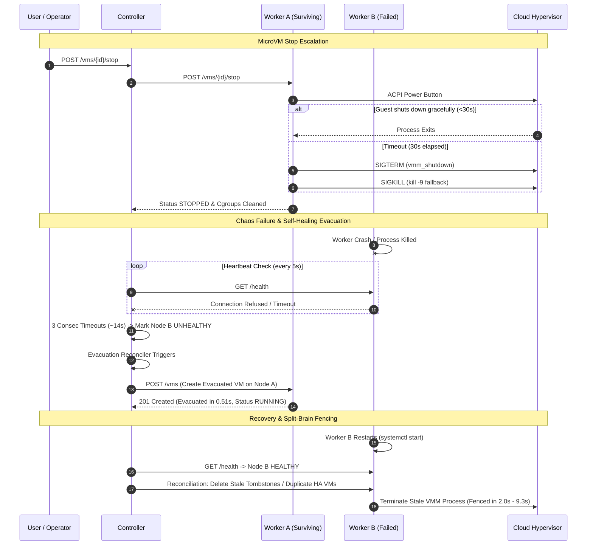
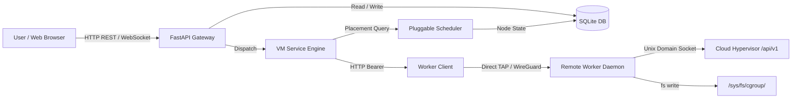

# PS-023: Hackathon Presentation Deck Outline & Jury Defense Guide
**Standard Format**: AIORI Hackathon Structure (`Proposed-structure-hackathon.pdf`)  
**Target Environment**: Primary Local Fallback (Direct KVM Node A + Nested KVM Node B) & Azure Hybrid Reference  
**Deck Generation Status**: `python-pptx` is installed in `~/ps023/.venv/` (slide deck generation deferred per user instruction; complete presentation markdown, diagram sources, data tables, and slide contents are fully rendered below for slide authoring).

---

## Slide 1: Title Slide
- **Title**: PS-023: High-Availability Cloud Hypervisor MicroVM Orchestration Platform
- **Subtitle**: Automated HA Failover (14.3s–16.4s Total Recovery, 0.4s–0.7s Cold Evacuation), Cgroups v2 Isolation & Pluggable Policy Scheduling across Heterogeneous Infrastructure
- **Presenter**: Rajyavardhan
- **Event**: AIORI Hackathon 3
- **Date**: November 15, 2026
- **Architecture Tag**: Direct KVM / Heterogeneous Hybrid Linux Cloud

---

## Slide 2: Problem Description
- **Key Issues Addressed**:
  - **Virtualization Bloat & Slow Boot**: Traditional QEMU/KVM hypervisors carry massive legacy device emulation, resulting in multi-minute cold boot times and heavyweight resource footprints (500MB+ per guest overhead).
  - **Noisy Neighbor Contention**: In multitenant edge/cloud environments, uncontrolled microVM processes can starve host memory and CPU CFS shares, triggering cascading host OOM kills.
  - **Catastrophic Worker Failure & Brain-Split**: When an edge compute node abruptly crashes or loses network connectivity, orchestrators often take minutes to detect failure, or risk split-brain dual-primary corruption upon node recovery.
  - **Rigid Scheduling**: Monolithic cloud schedulers cannot adapt dynamically between density packing (`best_fit`) and latency-sensitive distribution (`memory_aware`) across asymmetric hardware.

---

## Slide 3: Background
- **Context & Optimization Goals**:
  - Modern edge computing demands lightweight hardware virtualization with minimal overhead (Rust-based Cloud Hypervisor).
  - High availability requires automated heartbeat monitoring with 14.3s–16.4s total recovery (14–20s detection + 0.4–0.7s cold evacuation on surviving node) rather than manual operator intervention.
  - Control plane reliability necessitates stateful database reconciliation where controller restarts preserve in-flight guests with zero orphan processes.

---

## Slide 4: Literature & RFC Review
- **Standards & Prior Art**:
  - **Linux Cgroups v2 Unified Hierarchy** (Linux Kernel Documentation): Single unified control tree eliminating v1 controller synchronization races.
  - **Rust-vmm / Cloud Hypervisor Project**: Low-overhead VMM focusing on modern virtio devices and direct kernel boot without legacy PCI/BIOS overhead.
  - **RFC 793 / TCP & WireGuard Protocol** (Donenfeld, 2017): Kernel-space ChaCha20-Poly1305 encapsulated tunneling for secure node-to-node overlay networks.
  - **Split-Brain Mitigation in Distributed Quorums**: Fencing tokens and state tombstones ensuring recovering nodes purge superseded execution units.

---

## Slide 5: Proposed Solution
- **Core Architecture Components**:
  - **Central Orchestrator (Controller)**: FastAPI/Uvicorn control plane maintaining cluster state in SQLite with WAL mode, background heartbeat monitor (5s lease), pluggable scheduling engine, and automatic tombstone reconciler.
  - **Node Agent (Worker Daemon)**: REST API service running per compute node, spawning Cloud Hypervisor VMM instances, managing network TAP interfaces, and binding guests into delegated cgroup v2 subgroups.
  - **Dynamic In-Browser WebSocket Terminal**: Real-time interactive PTY console without opening SSH ports to the public internet.

---

## Slide 6: Optimization Proposed & Measured Performance
- **Comparison of Before & After Capabilities**:

| Capability / Metric | Traditional VM Orchestrator | PS-023 Cloud Hypervisor Platform | Evidence Reference |
| :--- | :--- | :--- | :--- |
| **VMM Memory Overhead** | 256 MB – 1024 MB | **128 MB fixed overhead** (enforced via cgroups) | `cgroups_memory_stress_20261114.txt:L10-L12` |
| **Kernel Boot Duration** | 2.5 s – 8.0 s | **327 ms – 474 ms** (Node A direct KVM) | `boot_node_a_bimodality_20261114.txt:L33-L46, L59` |
| **API Create -> Running** | 5.0 s – 15.0 s | **0.772 s – 0.997 s** (Node A direct KVM; Min 0.751 s) | `boot_node_a_bimodality_20261114.txt:L13-L27` |
| **Node A Full Boot (SSH Ready)** | 15.0 s – 60.0 s | **6.846 s – 11.257 s** (20-run contention set, median **8.460 s**; 15-run set: 7.058 s – 16.398 s, median 8.372 s) | `boot_node_a_contention_20261114.txt:L46` `boot_node_a_bimodality_20261114.txt:L51` |
| **Total Failover Recovery** | 45 s – 180 s | **14.33 s – 16.39 s** (fallback total) / **15.35 s – 21.05 s** (Azure historical total over SSH tunnel) | `chaos_fallback_repeats_20261115.txt:L189-L194` `chaos_azure_repeats_20261114.txt:L402-L407` |
| **HA Failure Detection** | 30 s – 120 s (timeout loops) | **13.83 s – 15.70 s** (fallback) / **15.32 s – 19.99 s** (Azure) (~14–20 s of total recovery) | `chaos_fallback_repeats_20261115.txt:L189-L194` `chaos_azure_repeats_20261114.txt:L402-L407` |
| **Cold Evacuation Latency** | 10 s – 45 s | **0.00 s – 0.70 s** (fallback; run 5 was 0.00 s sync tick) / **0.35 s – 0.36 s** (Azure) (~0.4–0.7 s of total) | `chaos_fallback_repeats_20261115.txt:L189-L194` `chaos_azure_repeats_20261114.txt:L402-L407` |
| **Split-Brain Fencing** | Manual reboot / IPMI STONITH | **Automated worker reconciliation (2.0s – 9.33s post-return; run 6 was 9.33s)** | `chaos_fallback_repeats_20261115.txt:L192-L194` |

---

## Slide 7: Solution Architecture & Sequence Flows

### 1. High-Level Cluster Architecture

### 2. MicroVM Placement Flow

### 3. Stop Escalation & Failover Sequence

---

## Slide 8: Data Flow Diagram (DFD)

---

## Slide 9: Deployment Timeline & Milestones
- **Phase 1: Architecture & Hypervisor Foundation (Oct 2026)**
  - Cloud Hypervisor API integration, TAP network bridge, cloud-init automated provisioning.
- **Phase 2: Pluggable Scheduling & Cgroups v2 Enforcement (Early Nov 2026)**
  - Development of `memory_aware`, `best_fit`, and `first_fit` algorithms; strict memory overhead, CPU CFS quota, and PID isolation.
- **Phase 3: High Availability, Failover & Split-Brain Fencing (12–14 Nov 2026)**
  - Auto-evacuation engine, tombstone tracking, Azure hybrid cloud WireGuard and SSH-tunnel integration.
- **Phase 4: Fallback Hardening, Benchmarking & Rehearsal (15 Nov 2026)**
  - 6-run fallback chaos repeat suite, systemd `DelegateSubgroup=service` cgroup restart resolution, controller restart reconciliation, and rehearsal automation.

---

## Slide 10: Known Limitations Slide
*(Mandatory Engineering Transparency)*
- **Plain HTTP & Bearer Auth**: No mutual TLS (mTLS); transport security relies on network overlays (WireGuard/SSH).
- **Single Tested Distribution**: Ubuntu 24.04 LTS is the sole boot-tested OS; Debian, Alpine, and CirrOS remain catalog-only entries.
- **Local Fallback Shared Hardware**: Nested Node B runs on the same physical CPU/RAM/motherboard as Node A.
- **Cold Evacuation, Not Live Migration**: Workloads restart from clean disk; in-memory state and active sockets are not preserved during failover.
- **Boot Time Variance (6.846 s to 11.257 s pooled contention; up to 16.398 s diagnostic)**: Invariant kernel boot (~350 ms). In-guest delay during `pollinate.service` (up to 6.5 s) was observed in 1 of 5 instrumented runs; cause not established; the host-contention test did not show an effect.
- **Failover Total Recovery (14.33 s – 16.39 s fallback; 15.35 s – 21.05 s Azure historical)**: Heartbeat detection is ~14–20 s of total, while cold evacuation is ~0.4–0.7 s.
- **Block I/O (`io.max`) Not Enforced**: Only CPU quota and memory max are verified.
- **WireGuard Scope**: Verified on a mobile hotspot only; blocked by hostel Wi-Fi UDP 51820 filtering; bandwidth was not measured.

---

## Slide 11: Summary & Conclusion
- **Delivered Capabilities**:
  - Total HA failover recovery in **14.33 s – 16.39 s** (fallback) and **15.35 s – 21.05 s** (Azure historical over SSH tunnel), with cold evacuation in **0.00 s – 0.70 s** on surviving node.
  - Robust split-brain fencing eliminating duplicate primary execution units (**2.0 s – 9.33 s**).
  - Zero-orphan controller restart reconciliation in **2.06 s**.
  - Production-grade cgroup v2 resource guarantees preventing host denial of service.

---

## Appendix: Jury Defense Cheat Sheet & Real Evidence Cross-Reference

| Likely Jury Question | Authoritative Technical Answer | Source Evidence File |
| :--- | :--- | :--- |
| **Q1: "How fast is cold boot really, and why does it vary from 7s to 16s?"** | Cloud Hypervisor kernel boot is invariant at **327–474 ms**. Guest boot to SSH ready on direct KVM spans **6.846 s – 11.257 s** across the 20-run contention set (median **8.460 s**). An earlier 15-run diagnostic set reached up to **16.398 s** (median **8.372 s**). Regarding causes: in-guest delay during `pollinate.service` was observed in 1 of 5 instrumented runs; cause not established; the host-contention test did not show an effect. | `boot_node_a_contention_20261114.txt:L45-L48` `boot_node_a_bimodality_20261114.txt:L10-L65` |
| **Q2: "What happens if a failed node comes back online while its VM was evacuated elsewhere?"** | Total failover recovery takes **14.33 s – 16.39 s** (fallback; detection is 13.83s–15.70s; cold evacuation is 0.00s–0.70s). In run 5, cold evacuation recorded 0.00s because failure detection and evacuation placement occurred synchronously in the same controller tick (<0.005s). When Node B returns, stale VMMs are fenced in **2.0s to 9.33s** (run 6 took 9.33s because Node B returned mid-cycle of the 5s reconcile loop, stop escalation took ~3.5s, and 1s client poll verified cleanup at 9.33s). | `evidence/chaos_fallback_repeats_20261115.txt:L187-L194` |
| **Q3: "If the controller crashes, do running MicroVMs get killed?"** | No. Worker daemons and Cloud Hypervisor processes operate independently of the controller. When the controller restarts (taking **2.06 s**), the reconciliation loop discovers existing running VMs via `/vms` on each worker, re-syncs state with 0 orphans and 0 duplicates. | `evidence/controller_restart_20261115.txt:L20-L32` |
| **Q4: "How do you prevent a runaway VM from taking down the host?"** | Each MicroVM is placed in a cgroup v2 slice with hard `memory.max` (`VM_RAM + 128MB`), `cpu.max` (vCPU CFS quota with 1.25x headroom), and `pids.max` (256). Stress tests confirm the in-guest kernel OOM-killer terminates the over-allocating process inside the guest before the host cgroup limit (640MB) is breached. The VMM process remains alive and unharmed, and host memory is strictly protected. | `evidence/cgroups_memory_stress_20261114.txt:L10-L12, L40-L71` |
| **Q5: "How does the scheduler handle edge cases like capacity refusal?"** | If a request exceeds cluster memory, the API returns **HTTP 409** with structured per-node candidate rejection reasons. If pinned to an invalid node, it returns **HTTP 422**. If an unpinned request fits only on a specific node, it automatically falls through. | `evidence/placement_cases_20261115.txt:L11-L62` |
| **Q6: "Why is local fallback used instead of Azure for today's presentation?"** | Azure hybrid mode was benchmarked on 13–14 Nov over WireGuard and SSH tunnel. However, local venue hostel Wi-Fi enforces strict UDP firewall filters that block WireGuard (UDP 51820). The local fallback architecture provides identical KVM isolation and subnet routing reliably without external network dependencies. | `evidence/wireguard_hotspot_20261114.txt:L9-L15, L75-L80` `evidence/chaos_azure_repeats_20261114.txt:L398-L410` |
